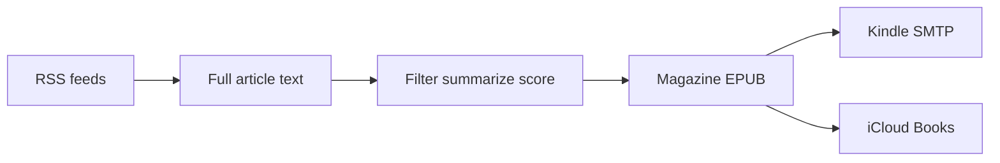

<h1 align="center">BiteSIze</h1>
<p align="center">
  <strong>A local morning magazine.</strong> RSS in, Kindle EPUB out.
</p>

<p align="center">
  <a href="https://github.com/victor-salles/bitesize/actions/workflows/ci.yml"></a>
  
  
  <a href="LICENSE"></a>
</p>

<p align="center">
  <a href="#features">Features</a> &nbsp;·&nbsp;
  <a href="#getting-started">Getting started</a> &nbsp;·&nbsp;
  <a href="#how-it-works">How it works</a> &nbsp;·&nbsp;
  <a href="#optional-phases">Optional phases</a> &nbsp;·&nbsp;
  <a href="#configuration">Configuration</a>
</p>

BiteSIze runs on one machine. It fetches the feeds you pick, pulls full article text, filters and summarizes with AI, and writes a magazine-style EPUB into `output/`. Kindle email and iCloud Books are extra steps: they fire when they are configured, and they are skipped when they are not.

> [!NOTE]
> This is a **single-user local tool**. The dashboard binds to `127.0.0.1` and is not meant to be exposed. Secrets stay in `.env` and `data/` — never in git.

## Features

- **Magazine EPUB** — section covers, a global cover, ranked stories, and reflowable HTML that a stock Kindle can open (no in-book JavaScript).
- **Local dashboard** — settings, RSS sources, live headline Preview, and a **Run digest** button that starts the same job as the morning run.
- **AI that can be down** — Claude Code CLI, Antigravity (`agy`), Gemini CLI, or Ollama. If none answer, the digest still writes: length-based scores, no summaries.
- **Optional delivery** — SMTP to `@kindle.com`, copy into iCloud Books. Failures never abort the EPUB.
- **Optional extra sections** — Gmail threads and Calendar events, off until you turn them on.
- **Optional Jev triage** — ads, compiled relevance from your ranked themes, `resumo` / `artigo-completo`, and pt-BR temas. Summaries still come from the writing model.
- **Paywall mirrors** when the first fetch is thin (archive.org is the one that sometimes helps).
- **Personal relevance** — describe your interests in prose and stories are scored on fit to you, with a keep threshold and a per-issue cap.
- **en / es / pt-BR**, with summaries optionally left in each article's own language.

## Getting started

You need [Python 3.13+](https://www.python.org/downloads/) and a terminal. macOS is assumed for iCloud Books and the daily LaunchAgent.

```bash
python3 -m venv .venv
source .venv/bin/activate
pip install -r requirements.txt
cp .env.example .env
python dashboard.py          # http://127.0.0.1:8765
```

Open the dashboard, add feeds, pick an AI backend, and paste the write-API token from `data/dashboard.token` (created on first run if `DASHBOARD_TOKEN` is unset). GET reads stay open on localhost; saves and **Run digest** need the token.

Then build a book:

```bash
python main.py --all                         # all enabled feeds
python main.py --all --no-kindle --no-books  # EPUB only
python main.py                               # interactive source pick
```

Output lands in `./output/`. With `ai_language=pt-BR` the file is named like `Resumo de Notícias - …`.

> [!IMPORTANT]
> `.env` and `sources.json` **seed** an empty database once. After that, live settings live in `data/bitesize.db`. Change them in the dashboard, not by re-editing `.env`.

### AI backend

The database default is **Antigravity** (`agy`) with `gemini-3.8-flash-high`, summaries in **pt-BR**. Switch backend and model in Settings.

| Backend | What you install |
| --- | --- |
| Antigravity (default) | `agy` CLI, authenticated |
| [Ollama](https://ollama.com/) | `ollama pull llama3:8b`, then `AI_BACKEND=ollama` |
| Gemini CLI | `npm install -g @google/gemini-cli`, then `AI_BACKEND=gemini` |

> [!TIP]
> You can try the pipeline with no AI at all. You will get a ranked EPUB without summaries. Ollama is the no-cloud option once a model is pulled.

## Reading what you actually care about

Upstream, the only thing that tells BiteSIze what you like is *which feeds you enable*. Relevance measures general newsworthiness — impact, timeliness, breadth of audience — and it is scored **relative to the other stories in the same batch of 20**, so a 70 in one batch does not mean what a 70 means in the next. Daily runs land 120–140 articles with no keep-list, which is more than anyone reads on a tablet.

This fork adds three settings that turn that into a personal digest.

| Setting | What it does |
| --- | --- |
| `user_interests` | Free text, in your own words. When set, relevance measures **fit to you** instead of general newsworthiness, scored per story on an absolute 0–100 scale with no forced curve. |
| `min_keep_score` | Drop anything below this score. Only meaningful once `user_interests` is set, because only then is the scale absolute. |
| `max_articles_per_issue` | Hard cap, highest score first. |
| `prefilter_keep` | Screen on titles first and carry only this many into the body fetch and the summarising pass. 0 disables it. |

With interests set, scores separate sharply — stories squarely in your interests land in the 85–100 band and off-topic ones fall below 30 — so a `min_keep_score` around 55–65 is usually the right starting point. Watch one run's scores before tightening it. If the threshold ever drops everything, the run keeps the five best stories and warns you rather than writing an empty book.

Two related behaviours change when `user_interests` is set:

- The **forced score spread** is dropped. Upstream requires one in five stories above 80 and one in five below 45 in every batch; that is wrong here, because a batch of twenty stories you do not care about should be allowed to score low across the board.
- The **clustered listwise re-rank** is skipped. It exists to spread out bunched-up scores, which would lift off-topic stories back over your threshold — and it costs an extra AI call per clustered batch.

### Two passes, not one

The cap alone trims the **book**, not the work: without `prefilter_keep`, every fetched article gets a body fetch and a summary before anything is filtered, so a large feed list pays to summarise stories the keep-list then discards. On a 45-feed list that was 269 articles and 14 summarising calls to keep 25.

`prefilter_keep` adds a cheap screening pass first. Titles alone go to the model, sixty per call, scored against the same interests; only the survivors get a body fetch and a summary. Set it comfortably above what you expect to keep, since a title is less informative than an article — with a 25-story cap and `min_keep_score=80`, 80 is a reasonable screen.

The screen **fails open** in every uncertain case: no interests, no AI backend, fewer articles than the keep count, or a batch that comes back unparseable all leave articles in rather than out. A rejected story here is never read at all, so the failure has to be the safe direction. Articles whose batch failed are held at a neutral score so they compete on order instead of being silently dropped.

Cross-feed duplicates are removed in the same place, before the body fetch. Overlapping feeds — a club feed and its parent sport feed, a wire service and the paper that runs it — were delivering the same story twice; upstream only deduplicated against the cover story, never within the article pool.

### Two languages in one book

`ai_language` sets the book's chrome (section labels, dates, tag names) and now accepts `en`, `es`, or `pt-BR`. `summary_language` controls the summaries separately:

- unset — follow `ai_language` (upstream behaviour)
- `source` — keep each summary in the language the article was written in
- `en` / `es` / `pt-BR` — translate every summary into that language

`source` is what a bilingual reader wants from a mixed feed list: English sources stay English, Spanish sources stay Spanish, and only the furniture around them is localised.

### Claude as the AI backend

`ai_backend=claude` drives the [Claude Code](https://claude.com/claude-code) CLI. With no `ANTHROPIC_API_KEY` set it uses your existing Claude subscription rather than per-token API billing; setting that variable switches it to the metered API. The backend strips the CLI's coding-agent system prompt and tool catalogue (`--restricted`, `--strict-mcp-config`, `--exclude-dynamic-system-prompt-sections`), which cuts per-call overhead from roughly 19k tokens to 6k. `claude_model` defaults to Haiku, which is enough for batch JSON.

### Keeping storage flat

Upstream keeps every EPUB in `output/` forever. `output_keep_issues` prunes to the newest N after each successful run (0 keeps everything, the old behaviour).

Delivery to an iPad is better served by iCloud Books than by Kindle email: Amazon never auto-deletes Send-to-Kindle personal documents and gives you no automation for cleanup, while deleting from Books on the iPad propagates everywhere. Run with `--no-kindle`.

## How it works

`main.py` is the only orchestrator. The daily job and the dashboard **Run digest** button both call `python main.py --all`.



1. **Fetch** enabled feeds in parallel, then the article bodies. If a body is thin, try archive mirrors.
2. **Optional Gmail / Calendar** inject extra sections when those flags are on.
3. **Filter, summarize, score** in batches. Jev can run first when it is enabled and keyed. Headline-only items are dropped.
4. **Assemble** section covers, a global cover, and magazine layers (hero, teasers, ranked list).
5. **Write** the EPUB. Then send and copy if those phases are configured.

Stories carry a 0–100 relevance score (shown as 0–10 in the book). Sections sort highest-first. Tags on each story: `resumo` or `artigo-completo`, plus temas from a fixed pt-BR list.

Stock Kindle has **no JavaScript**. The book uses internal links, covers, and reflowable HTML only. For a layout closer to e-ink than Apple Books, use [Kindle Previewer 3](https://www.amazon.com/gp/feature.html?docId=1003018611).

## Optional phases

Each phase works when its settings are present and is skipped when they are not. Delivery is best-effort.

### Kindle

Set `KINDLE_EMAIL` (`you@kindle.com`) and Gmail SMTP. Use a [Google App Password](https://myaccount.google.com/apppasswords), not your normal password. Whitelist the sender under Amazon → Personal Document Settings.

Skip with `--no-kindle` or by turning off Kindle delivery in Settings.

> [!WARNING]
> Amazon does not auto-delete Send-to-Kindle personal documents. Each morning’s file has a new name, so the library grows. Periodically delete old digests in [Manage Your Content](https://www.amazon.com/mycd) (filter **Docs**), then sync the device.

### iCloud Books

On by default. The EPUB is copied into the Mac Books folder so it can sync to iPhone/iPad. Skip with `--no-books`. If auto-detection fails, set `icloud_books_dir` in the dashboard.

### Gmail and Calendar

Off by default. Enable them under Integrations, with `credentials.json` / `token.json` on the machine. The daily `--all` run honors those flags and does not prompt.

### Jev

Off by default. Put a TypeSafe key or a Vercel AI Gateway `vck_…` key in `.env`, then turn on `jev_triage_enabled`. The Jev tab lists each classify run under `output/jev/`. Set `jev_min_keep` (for example `40` on the 0–100 scale) to drop weak stories.

## Daily run (macOS)

```bash
./scripts/install-daily-launchd.sh
```

Runs `.venv/bin/python main.py --all` at **06:50** local time. Logs: `output/logs/digest-stdout.log`. Uninstall:

```bash
launchctl unload ~/Library/LaunchAgents/com.bitesize.digest.plist
rm ~/Library/LaunchAgents/com.bitesize.digest.plist
```

## Configuration

| Place | Role |
| --- | --- |
| `data/bitesize.db` | Runtime settings and RSS sources |
| `.env` / `sources.json` | Seed only, first migrate |
| `data/dashboard.token` | Write-API Bearer token if env is unset |
| `credentials.json` | Google OAuth client (Gmail / Calendar) |

Dashboard: `python dashboard.py` → http://127.0.0.1:8765

| Tab | What it is for |
| --- | --- |
| Settings | AI, language, delivery, integrations |
| Sources | Categories and feeds |
| Preview | Live headlines (five at first, then show more) |
| Jev | Classify runs and label export |
| Kindle | Delivery status |

## Troubleshooting

**Digest wrote but has no summaries.** The AI backend exited. Check `agy models` / Ollama / Gemini CLI. Retired `gemini-3.5-flash-*` ids map to 3.8 Flash at call time.

**Preview says no headlines.** The fetch is ignoring HTTP proxies on purpose. A real 403 (some AP News URLs) still fails that one source; other feeds keep running.

**Kindle never arrives.** Confirm App Password, approved sender, and `kindle_delivery_enabled`. The EPUB is already in `output/` either way.

**Books copy failed.** Delivery is best-effort. Check `icloud_books_dir` or skip with `--no-books`.

Tests:

```bash
pip install -r requirements-dev.txt
pytest tests/ -v --cov
```

## More

| Doc | For |
| --- | --- |
| [ROADMAP.md](ROADMAP.md) | What is shipped vs what comes next |
| [ISSUES.md](ISSUES.md) | Known problems in the running app |
| [docs/LOCAL_DEV.md](docs/LOCAL_DEV.md) | Dev commands |
| [SECURITY.md](SECURITY.md) | Threat model and how to report issues |
| [CLAUDE.md](CLAUDE.md) | Agents working in this repo |
