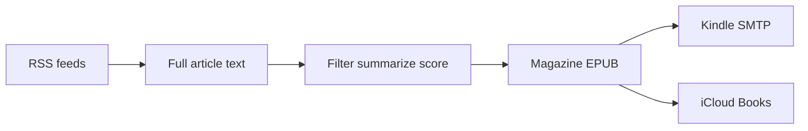

<h1 align="center">BiteSIze</h1>
<p align="center">
  <strong>A local morning magazine.</strong> RSS in, Kindle EPUB out.
</p>

<p align="center">
  <a href="https://github.com/victor-salles/bitesize/actions/workflows/ci.yml"></a>
  
  
  <a href="LICENSE"></a>
</p>

<p align="center">
  <a href="#features">Features</a> &nbsp;·&nbsp;
  <a href="#getting-started">Getting started</a> &nbsp;·&nbsp;
  <a href="#how-it-works">How it works</a> &nbsp;·&nbsp;
  <a href="#optional-phases">Optional phases</a> &nbsp;·&nbsp;
  <a href="#configuration">Configuration</a>
</p>

BiteSIze runs on one machine. It fetches the feeds you pick, pulls full article text, filters and summarizes with AI, and writes a magazine-style EPUB into `output/`. Kindle email and iCloud Books are extra steps: they fire when they are configured, and they are skipped when they are not.

> [!NOTE]
> This is a **single-user local tool**. The dashboard binds to `127.0.0.1` and is not meant to be exposed. Secrets stay in `.env` and `data/` — never in git.

## Features

- **Magazine EPUB** — section covers, a global cover, ranked stories, and reflowable HTML that a stock Kindle can open (no in-book JavaScript).
- **Local dashboard** — settings, RSS sources, live headline Preview, and a **Run digest** button that starts the same job as the morning run.
- **AI that can be down** — Claude Code CLI, Antigravity (`agy`), Gemini CLI, or Ollama. If none answer, the digest still writes: length-based scores, no summaries.
- **Optional delivery** — SMTP to `@kindle.com`, copy into iCloud Books. Failures never abort the EPUB.
- **Optional extra sections** — Gmail threads and Calendar events, off until you turn them on.
- **Optional Jev triage** — ads, compiled relevance from your ranked themes, `resumo` / `artigo-completo`, and pt-BR temas. Summaries still come from the writing model.
- **Paywall mirrors** when the first fetch is thin (archive.org is the one that sometimes helps).
- **Personal relevance** — describe your interests in prose and stories are scored on fit to you, with a keep threshold and a per-issue cap.
- **en / es / pt-BR**, with summaries optionally left in each article's own language.

## Getting started

You need [Python 3.13+](https://www.python.org/downloads/) and a terminal. macOS is assumed for iCloud Books and the daily LaunchAgent.

```bash
./run.sh dashboard           # sets up .venv on first run → http://127.0.0.1:8765
```

`run.sh` creates the virtualenv, installs `requirements.txt`, and runs through `.venv/bin/python`. Doing it by hand works too, but **run the project's interpreter, not a bare `python`** — a bare `python dashboard.py` picks up your system install, which has none of these dependencies:

```bash
python3 -m venv .venv
source .venv/bin/activate
pip install -r requirements.txt
cp .env.example .env
python dashboard.py          # http://127.0.0.1:8765
```

Open the dashboard, add feeds, pick an AI backend, and paste the write-API token from `data/dashboard.token` (created on first run if `DASHBOARD_TOKEN` is unset):

```bash
cat data/dashboard.token
```

The field reports **"Write token accepted"** or **"Token rejected"** as soon as you paste, so a stale or mistyped token is obvious before you click something destructive. GET reads stay open on localhost; every save, delete and rebuild needs the token, and without it they fail with 401.

> [!TIP]
> The field is deliberately a plain text input, not a password one — browsers autofill saved passwords into password fields on `localhost`, which silently replaces the token with something that looks right and 401s on every write.

Then build a book:

```bash
./run.sh pool                                # screen candidates to pick from
./run.sh build                               # publish what you kept
./run.sh digest --all                        # or do it all unattended
./run.sh digest --all --no-kindle --no-books # EPUB only
./run.sh                                     # interactive source pick
```

Or directly, with the venv active: `python main.py --all`.

Output lands in `./output/`. With `ai_language=pt-BR` the file is named like `Resumo de Notícias - …`.

> [!IMPORTANT]
> `.env` and `sources.json` **seed** an empty database once. After that, live settings live in `data/bitesize.db`. Change them in the dashboard, not by re-editing `.env`.

### AI backend

The database default is **Antigravity** (`agy`) with `gemini-3.8-flash-high`, summaries in **pt-BR**. Switch backend and model in Settings.

| Backend | What you install |
| --- | --- |
| Antigravity (default) | `agy` CLI, authenticated |
| [Ollama](https://ollama.com/) | `ollama pull llama3:8b`, then `AI_BACKEND=ollama` |
| Gemini CLI | `npm install -g @google/gemini-cli`, then `AI_BACKEND=gemini` |

> [!TIP]
> You can try the pipeline with no AI at all. You will get a ranked EPUB without summaries. Ollama is the no-cloud option once a model is pulled.

## Reading what you actually care about

Upstream, the only thing that tells BiteSIze what you like is *which feeds you enable*. Relevance measures general newsworthiness — impact, timeliness, breadth of audience — and it is scored **relative to the other stories in the same batch of 20**, so a 70 in one batch does not mean what a 70 means in the next. Daily runs land 120–140 articles with no keep-list, which is more than anyone reads on a tablet.

This fork adds three settings that turn that into a personal digest.

| Setting | What it does |
| --- | --- |
| `user_interests` | Free text, in your own words. When set, relevance measures **fit to you** instead of general newsworthiness, scored per story on an absolute 0–100 scale with no forced curve. |
| `min_keep_score` | Drop anything below this score. Only meaningful once `user_interests` is set, because only then is the scale absolute. |
| `max_articles_per_issue` | Hard cap, highest score first. |
| `prefilter_keep` | Screen on titles first and carry only this many into the body fetch and the summarising pass. 0 disables it. |
| `prefilter_min_per_section` | Reserve this many title-screen slots per section, so small sections survive to the keep-list. |
| `min_section_stories` | Admit this many best stories per section even below `min_keep_score`. |
| `balance_sections` | Fill the cap round-robin across sections instead of by absolute score. |
| `overflow_section_max` | Publish the stories that lost their slot as a trailing "Also considered" section. |

With interests set, scores separate sharply — stories squarely in your interests land in the 85–100 band and off-topic ones fall below 30 — so a `min_keep_score` around 55–65 is usually the right starting point. Watch one run's scores before tightening it. If the threshold ever drops everything, the run keeps the five best stories and warns you rather than writing an empty book.

Two related behaviours change when `user_interests` is set:

- The **forced score spread** is dropped. Upstream requires one in five stories above 80 and one in five below 45 in every batch; that is wrong here, because a batch of twenty stories you do not care about should be allowed to score low across the board.
- The **clustered listwise re-rank** is skipped. It exists to spread out bunched-up scores, which would lift off-topic stories back over your threshold — and it costs an extra AI call per clustered batch.

### Why a balanced issue needs two settings, not one

Ranking by absolute score hands the issue to whichever sections score well every day. On a real run that was `Opinion 9, Tech 6, Science 4, Soccer 3, World 2, Español 1` — and nothing at all from Agriculture, Art, US Politics or México.

`balance_sections` fills the cap round-robin instead: sections are visited strongest-first by their own lead story, then cycled, so every section's lead is in before any section's second. On its own that **did not fix it** — Opinion still took 9 of 25.

The cap was never the real constraint. `min_keep_score` was. An art review or a planting guide rarely out-scores AI commentary when both are judged against the same interests, so those sections were already empty by the time balancing ran. `min_section_stories` admits each section's best few regardless of the threshold; they then compete on score like everything else. With both set, the same feeds produced:

`Tech 4, Science 4, Soccer 4, Opinion 4, Español 2, World 2, Agriculture 2, Art 2, US Politics 1`

The rescued stories score 6.5–7.8 — well under the threshold, and precisely the ones that were being dropped.

`overflow_section_max` publishes what lost its slot as a trailing "Also considered" section, best-scoring first. Those stories are already summarised, so carrying them costs EPUB bytes and no AI calls.

A section can still go missing one stage earlier. The title screen cuts on score too, and interleaves only at equal scores, so a section whose headlines all read weakly is gone before the keep-list runs — `min_section_stories` cannot rescue what never survived the screen. `prefilter_min_per_section` reserves screen slots for each section's best headlines; when reservations exceed `prefilter_keep`, the best-scoring reservations win rather than overflowing the budget.

With all three set, every configured section reached the issue:

`Soccer 4, Opinion 3, Science 3, Tech 3, Agriculture 2, Art 2, Español 2, México 2, US Politics 2, World 2`

### Two passes, not one

The cap alone trims the **book**, not the work: without `prefilter_keep`, every fetched article gets a body fetch and a summary before anything is filtered, so a large feed list pays to summarise stories the keep-list then discards. On a 45-feed list that was 269 articles and 14 summarising calls to keep 25.

`prefilter_keep` adds a cheap screening pass first. Titles alone go to the model, sixty per call, scored against the same interests; only the survivors get a body fetch and a summary. Set it comfortably above what you expect to keep, since a title is less informative than an article — with a 25-story cap and `min_keep_score=80`, 80 is a reasonable screen.

The screen **fails open** in every uncertain case: no interests, no AI backend, fewer articles than the keep count, or a batch that comes back unparseable all leave articles in rather than out. A rejected story here is never read at all, so the failure has to be the safe direction. Articles whose batch failed are held at a neutral score so they compete on order instead of being silently dropped.

Cross-feed duplicates are removed in the same place, before the body fetch. Overlapping feeds — a club feed and its parent sport feed, a wire service and the paper that runs it — were delivering the same story twice; upstream only deduplicated against the cover story, never within the article pool.

### Two languages in one book

`ai_language` sets the book's chrome (section labels, dates, tag names) and now accepts `en`, `es`, or `pt-BR`. `summary_language` controls the summaries separately:

- unset — follow `ai_language` (upstream behaviour)
- `source` — keep each summary in the language the article was written in
- `en` / `es` / `pt-BR` — translate every summary into that language

`source` is what a bilingual reader wants from a mixed feed list: English sources stay English, Spanish sources stay Spanish, and only the furniture around them is localised.

Getting that reliable took three attempts, measured on real issues rather than guessed:

| Prompt | Summaries in the wrong language |
| --- | --- |
| One global "match the article's own language" rule | 6 of 44 (13.6%) |
| Each article tagged `(language: xx)` | 2 of 38 (5.3%) |
| Tags + monolingual batches + tag declared authoritative | 0 of 42 |

A single instruction cannot hold a 25-article batch drawn from mixed-language feeds together: the model lets one article's language set its neighbours'. Tagging each article from a stopword detector cut most of it. What remained were **Spanish articles about anglophone subjects** — English media criticising a Liverpool player, Latino voters in Texas — where the subject matter dragged the summary into English despite a correct tag. So the rule now states that what a story is *about* never changes the language it is written *in*, and batches are grouped by detected language so there is no mixed context left to drift across. Grouping rounds up per language, which in practice cost no extra calls.

`detect_language` returns `""` rather than guessing when the signal is weak, and untagged articles fall back to matching their own body. Spanish and Portuguese share most of their function words, so naming either needs a two-word lead; English separates on one.

### Claude as the AI backend

`ai_backend=claude` drives the [Claude Code](https://claude.com/claude-code) CLI. With no `ANTHROPIC_API_KEY` set it uses your existing Claude subscription rather than per-token API billing; setting that variable switches it to the metered API. The backend strips the CLI's coding-agent system prompt and tool catalogue (`--restricted`, `--strict-mcp-config`, `--exclude-dynamic-system-prompt-sections`), which cuts per-call overhead from roughly 19k tokens to 6k. `claude_model` defaults to Haiku, which is enough for batch JSON.

### Keeping AI usage down

The Claude backend draws on a subscription, so cost is measured in usage, not dollars. Upstream's shape was expensive in two ways that are easy to miss, and both were found by measuring rather than reasoning.

**Thinking was most of the bill.** The CLI enables extended thinking by default. Every prompt here asks for a JSON array, so none of it helps. On a ten-article batch, thinking was 1,515 of 2,139 output tokens — 20.4s instead of 8.7s, for identical output. `claude_thinking_tokens` defaults to 0 and sets `MAX_THINKING_TOKENS` on the call. Raise it only if summary quality drops.

**Covers were nearly half the calls.** A run made 16 AI calls: five to screen titles, four to summarise, and **seven for covers** — one per section plus a global pass. `epub.py` already builds a readable fallback cover without AI, so `ai_covers_enabled=false` removes seven calls for no loss of article content. `prefilter_batch_size` (150) takes the title screen from five calls to two.

Measured on a 45-feed, 269-article run, both at six calls:

| | calls | input (incl. cache) | output | wall time |
| --- | --- | --- | --- | --- |
| Thinking on | 6 | 54,265 | 62,014 | 7.8 min |
| Thinking off | 6 | 53,200 | **11,778** | **1.6 min** |

Two things worth knowing before trying to reason about this yourself:

- **The prompt cache never helps.** Each `claude -p` is a fresh process, so `cache_read` is 0 on every call while `cache_write` is paid every time — and cache writes cost *more* than plain input. Fewer, larger calls is the only lever on input.
- **Measure, do not estimate.** Both intuitions above ("overhead dominates", "caching amortises it") were wrong in opposite directions. `claude_backend` appends real per-call token counts to `output/logs/ai-usage.jsonl`; `python scripts/ai-usage.py --calls` totals them by day or call kind.

If usage is still too high, `ai_backend=ollama` removes it entirely. On Apple silicon with 24 GB, `qwen2.5:14b` is a better choice than the repo's default `llama3:8b` — it follows JSON instructions more reliably, which is all this pipeline asks of a model.

### Reaching the dashboard from a tablet

The dashboard binds to `127.0.0.1` and should stay there. To pick from an iPad, put a tunnel in front of it rather than opening the port.

**1. Set a password first.** This is not optional, and the reason is specific:

```bash
./run.sh set-password
```

Without one, the dashboard trusts its loopback bind — `GET` routes are open and only writes need a token. A tunnel breaks that assumption, because it forwards from the tailnet to `127.0.0.1`, so every request arrives looking local. With a password set, **every** `/api/` route needs a session or the bearer token, reads included; static files stay open so the login page can load.

**2. Expose it through Tailscale.** Install Tailscale on the Mac and the iPad and sign both into the same tailnet, then:

```bash
tailscale serve --bg 8765
tailscale serve status        # prints the https://<machine>.<tailnet>.ts.net URL
```

Tailscale terminates TLS and forwards to `127.0.0.1:8765`, so the app keeps its loopback bind and you get HTTPS without certificates. Open that URL on the iPad and log in. Once you only ever reach it that way, turn on `dashboard_cookie_secure` so the session cookie refuses plain HTTP.

Plain `ssh -L 8765:localhost:8765 you@mac` works too, and needs no new software, but the tunnel has to be re-established and iOS SSH clients make that tedious.

**If `tailscale serve` is unavailable**, `dashboard_host` can bind the dashboard straight to the tailnet address instead:

| Value | Listens on |
| --- | --- |
| `127.0.0.1` (default) | loopback only |
| `tailscale` | this machine's `100.x` tailnet address, auto-detected |
| an IP, or `0.0.0.0` | exactly that |

Tailscale encrypts node-to-node traffic with WireGuard, so a tailnet bind is private without TLS. Two things to know before using it: **a non-loopback bind is refused outright unless a password is set** — the bind was the only thing keeping reads private, so the dashboard stays on loopback and says so rather than exposing them — and **you cannot reach your own tailnet address from the same Mac**, because Tailscale's network extension does not hairpin traffic back to itself. Binding to `tailscale` therefore makes the dashboard reachable from your other devices but *not* from the Mac running it. `tailscale serve` avoids that trade-off, which is why it is the first recommendation.

> [!WARNING]
> Do not reach for `HOST = "0.0.0.0"`. There is no TLS in the application, one account, and no rate limiting beyond the login throttle. The tunnel is what makes this safe.

Passwords are stored as an scrypt hash with a per-password salt in `data/dashboard_auth.json` (mode `0600`); the plaintext is never written. `./run.sh set-password --clear` returns to the token-only model.

### Picking the day's stories yourself

The expensive half of a run is downloading article bodies and summarising them, and that used to happen to everything the title screen kept — eighty articles to publish twenty-five. Putting the decision between those two phases is both cheaper and more controllable: **only what you keep gets fetched and summarised.**

So a run splits in two.

```bash
./run.sh pool      # fetch, dedupe, screen → a pool of candidates. 2 AI calls.
./run.sh build     # summarise what you kept → EPUB → Books
```

`pool` downloads no articles and writes no book. `build` only touches what you picked. On a 47-feed setup that measured **2 calls / $0.05** for the pool and **1 call / $0.02** for a six-article build — against $0.157 for the fully automatic run.

The **Pool** tab is the picking interface. One card at a time, showing section, source, screen score, headline and the feed's preview text:

- **Swipe or drag** the card — right keeps, left skips. Works with a mouse, a trackpad or a finger.
- **← / → / Z** on a keyboard: skip, keep, undo.
- *Everything else in this pool* expands the full list, grouped by section, so you can see what you passed on and pull something back at any point before building.
- **Build issue** summarises your keepers and publishes. **New pool** re-screens from scratch.

Because you have already curated, a pooled build does **not** apply `min_keep_score` or `max_articles_per_issue` — your picks are the issue. Sections are still ordered by score, and the result is recorded in the Issue tab like any other.

> [!IMPORTANT]
> `--pool` publishes nothing. The daily LaunchAgent now builds a pool and stops, so an unattended morning costs two AI calls and produces no book until you pick. If you would rather it publish on its own, run `--all` instead, which is the original behaviour and still fully supported.

The dashboard stays bound to `127.0.0.1`. To pick from a tablet, reach it over Tailscale or an SSH tunnel rather than exposing the port — `GET` reads need no token, so the bind is the only thing keeping settings off your network.

### Reviewing what a run picked

A run's article list only ever lived in memory, so once the EPUB was written there was no record of what had been chosen and no way to drop a story without regenerating the digest and paying for the AI again.

Each run now records its picks to SQLite, and the dashboard's **Issue** tab edits them in place: pick a run, untick anything unwanted (or **Drop section** for a whole one), then **Rebuild EPUB**. The rebuild writes the book again without the dropped stories and re-copies it to Books.

**A rebuild costs no AI calls.** Summaries, tags and scores are already stored, and covers use the non-AI fallback layout.

- A section emptied by removals disappears rather than leaving a blank front page.
- Scores from the length-based fallback render greyed out, so a real model score is distinguishable from a stand-in.
- Stored issues prune alongside the EPUBs, on the same `output_keep_issues` count.
- Recording is wrapped so bookkeeping can never fail a finished digest.
- The rebuilt file can be *larger* even with fewer stories: the cover JPEG is regenerated and dominates the file, so its compression varies by more than the removed text weighs.

API, all under the dashboard's usual rule that writes need the Bearer token:

| Route | Does |
| --- | --- |
| `GET /api/issues` | Recent runs with kept/stored counts |
| `GET /api/issues/<id>` | One issue by section (bodies omitted) |
| `PUT /api/issues/<id>/articles` | `{ids: [...], excluded: bool}` |
| `POST /api/issues/<id>/rebuild` | `{deliver: bool}` |
| `DELETE /api/issues/<id>` | Forget the record; leaves the EPUB alone |

### Keeping storage flat

Upstream keeps every EPUB in `output/` forever. `output_keep_issues` prunes to the newest N after each successful run (0 keeps everything, the old behaviour).

Delivery to an iPad is better served by iCloud Books than by Kindle email: Amazon never auto-deletes Send-to-Kindle personal documents and gives you no automation for cleanup, while deleting from Books on the iPad propagates everywhere. Run with `--no-kindle`.

## How it works

`main.py` is the only orchestrator. The daily job and the dashboard **Run digest** button both call `python main.py --all`.



1. **Fetch** enabled feeds in parallel, then the article bodies. If a body is thin, try archive mirrors.
2. **Optional Gmail / Calendar** inject extra sections when those flags are on.
3. **Filter, summarize, score** in batches. Jev can run first when it is enabled and keyed. Headline-only items are dropped.
4. **Assemble** section covers, a global cover, and magazine layers (hero, teasers, ranked list).
5. **Write** the EPUB. Then send and copy if those phases are configured.

Stories carry a 0–100 relevance score (shown as 0–10 in the book). Sections sort highest-first. Tags on each story: `resumo` or `artigo-completo`, plus temas from a fixed pt-BR list.

Stock Kindle has **no JavaScript**. The book uses internal links, covers, and reflowable HTML only. For a layout closer to e-ink than Apple Books, use [Kindle Previewer 3](https://www.amazon.com/gp/feature.html?docId=1003018611).

## Optional phases

Each phase works when its settings are present and is skipped when they are not. Delivery is best-effort.

### Kindle

Set `KINDLE_EMAIL` (`you@kindle.com`) and Gmail SMTP. Use a [Google App Password](https://myaccount.google.com/apppasswords), not your normal password. Whitelist the sender under Amazon → Personal Document Settings.

Skip with `--no-kindle` or by turning off Kindle delivery in Settings.

> [!WARNING]
> Amazon does not auto-delete Send-to-Kindle personal documents. Each morning’s file has a new name, so the library grows. Periodically delete old digests in [Manage Your Content](https://www.amazon.com/mycd) (filter **Docs**), then sync the device.

### iCloud Books

On by default. The EPUB is copied into the Mac Books folder so it can sync to iPhone/iPad. Skip with `--no-books`. If auto-detection fails, set `icloud_books_dir` in the dashboard.

iCloud Books exists only on macOS. On a Linux host, open the dashboard's **Issue** tab on the phone and tap **Download EPUB** instead; Safari offers to open it in Books. The file is served from `output/` by name (`epub_download.py`), so it keeps working after the repo moves between machines.

### Gmail and Calendar

Off by default. Enable them under Integrations, with `credentials.json` / `token.json` on the machine. The daily `--all` run honors those flags and does not prompt.

### Jev

Off by default. Put a TypeSafe key or a Vercel AI Gateway `vck_…` key in `.env`, then turn on `jev_triage_enabled`. The Jev tab lists each classify run under `output/jev/`. Set `jev_min_keep` (for example `40` on the 0–100 scale) to drop weak stories.

## Daily run (macOS)

```bash
./scripts/install-daily-launchd.sh
```

Runs `caffeinate -i .venv/bin/python main.py --all --pool` at **06:50** local
time, so the morning builds a candidate pool and publishes nothing until you
pick. `caffeinate` holds off idle sleep for the length of the run; waking a
sleeping Mac is a separate `pmset` job the script prints. Logs:
`output/logs/digest-stdout.log`. Uninstall:

```bash
launchctl unload ~/Library/LaunchAgents/com.bitesize.digest.plist
rm ~/Library/LaunchAgents/com.bitesize.digest.plist
```

## Keeping the dashboard up (macOS)

```bash
./scripts/install-dashboard-launchd.sh
```

Starts the dashboard at login and restarts it whenever it exits. This is what
makes a tunnel usable: `tailscale serve` only proxies to `127.0.0.1:8765`, so a
dashboard started by hand takes the remote URL down with its terminal. The
installer stops any dashboard already running first, because a second listener
on the port would crash-loop under `KeepAlive`. Logs:
`output/logs/dashboard-stdout.log`. Uninstall:

```bash
launchctl unload ~/Library/LaunchAgents/com.bitesize.dashboard.plist
rm ~/Library/LaunchAgents/com.bitesize.dashboard.plist
```

With the agent loaded, do not also run `./run.sh dashboard` — `launchctl
unload` first if you want the terminal copy.

## Running on a Raspberry Pi (Linux)

An always-on box removes every sleep problem above: the dashboard stays reachable and the 06:50 run happens whether or not the laptop is open.

From the Mac, with the Pi already on your tailnet and reachable by SSH key:

```bash
./scripts/move-to-pi.sh you@pi-home            # add --with-google to copy token.json / credentials.json
ssh -t you@pi-home '~/.local/bin/claude'       # log the AI backend in once
```

`move-to-pi.sh` stops the Mac LaunchAgents, copies the repo with `data/`, `output/` and `.env`, rewrites stored EPUB paths for the new home, turns iCloud Books delivery off, builds `.venv`, runs the tests, and installs the systemd units with `scripts/install-linux-systemd.sh`:

| Unit | Does |
| --- | --- |
| `bitesize-dashboard.service` | `dashboard.py` on `127.0.0.1:8765`, started at boot, restarted on exit |
| `bitesize-digest.timer` | `main.py --all --pool` daily at 06:50 Pi time; `Persistent=true` runs a missed day at boot |

Then `tailscale serve --bg --https=443 8765` publishes it (on 8444 instead if something such as Pi-hole already holds 443 on the Pi), and the script turns the Mac's 443 mapping off once the Pi answers. Logs stay in `output/logs/`. Check with `systemctl status bitesize-dashboard bitesize-digest.timer`; run the pool now with `sudo systemctl start bitesize-digest`.

To ship later changes from the Mac: `scripts/deploy-to-pi.sh`. It sends the code but never `data/`, `output/`, `.env` or Google tokens, runs the test suite on the Pi, restarts `bitesize-dashboard`, and rolls back to the previous version if the tests or the health check fail. The 06:50 timer picks up the new code on its next run.

## Configuration

| Place | Role |
| --- | --- |
| `data/bitesize.db` | Runtime settings and RSS sources |
| `.env` / `sources.json` | Seed only, first migrate |
| `data/dashboard.token` | Write-API Bearer token if env is unset |
| `credentials.json` | Google OAuth client (Gmail / Calendar) |

Dashboard: `python dashboard.py` → http://127.0.0.1:8765

| Tab | What it is for |
| --- | --- |
| Settings | AI, language, delivery, integrations |
| Sources | Categories and feeds |
| Pool | Swipe screened headlines; build an issue from your picks |
| Issue | What the last runs picked; drop stories and rebuild |
| Preview | Live headlines (five at first, then show more) |
| Kindle | Delivery status |

## Troubleshooting

**Digest wrote but has no summaries.** The AI backend exited. Check `agy models` / Ollama / Gemini CLI. Retired `gemini-3.5-flash-*` ids map to 3.8 Flash at call time.

**Preview says no headlines.** The fetch is ignoring HTTP proxies on purpose. A real 403 (some AP News URLs) still fails that one source; other feeds keep running.

**Kindle never arrives.** Confirm App Password, approved sender, and `kindle_delivery_enabled`. The EPUB is already in `output/` either way.

**Books copy failed.** Delivery is best-effort. Check `icloud_books_dir` or skip with `--no-books`.

Tests:

```bash
pip install -r requirements-dev.txt
pytest tests/ -v --cov
```

## More

| Doc | For |
| --- | --- |
| [ROADMAP.md](ROADMAP.md) | What is shipped vs what comes next |
| [ISSUES.md](ISSUES.md) | Known problems in the running app |
| [docs/LOCAL_DEV.md](docs/LOCAL_DEV.md) | Dev commands |
| [SECURITY.md](SECURITY.md) | Threat model and how to report issues |
| [CLAUDE.md](CLAUDE.md) | Agents working in this repo |
